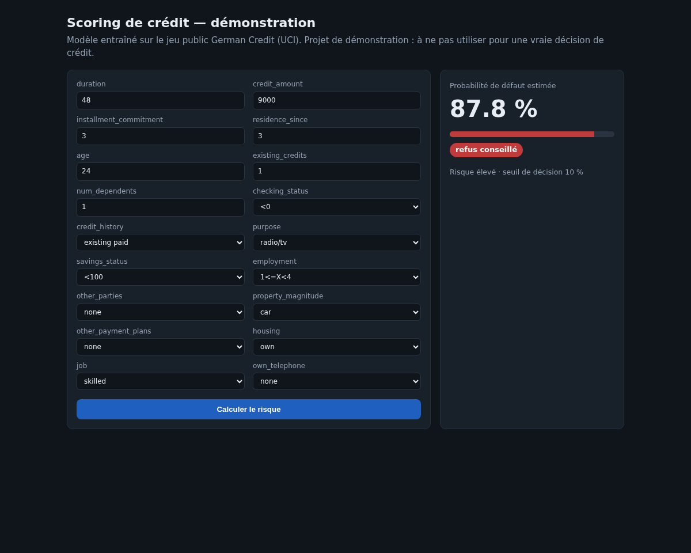
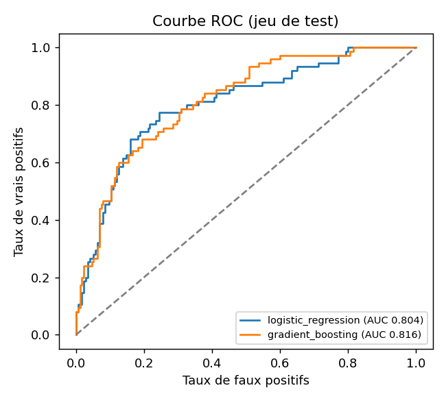
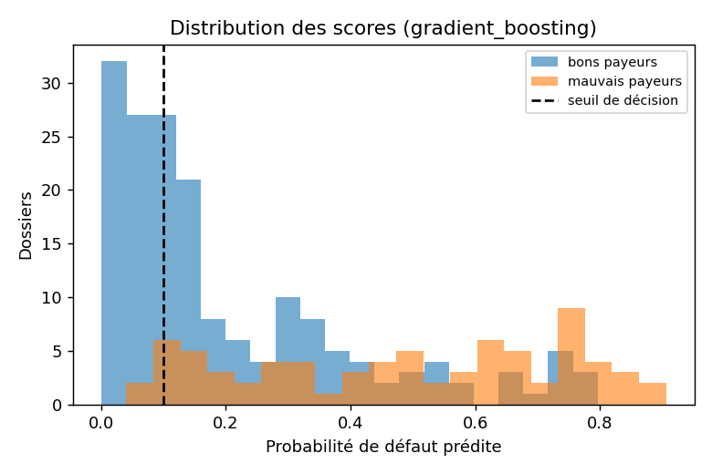
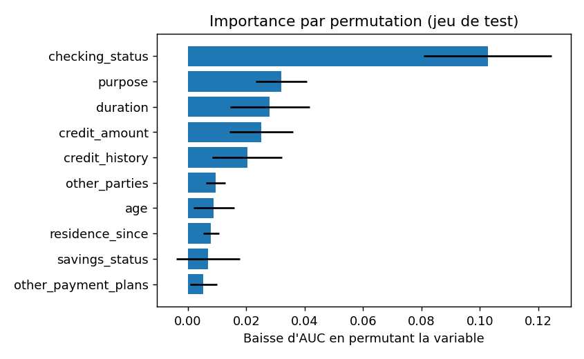

# Credit Scoring ML (scikit-learn + FastAPI)

Modèle de **scoring de crédit** de bout en bout sur un jeu public : préparation, comparaison de modèles, choix d'un seuil de décision selon une matrice de coûts, explicabilité, suivi de dérive (PSI), API FastAPI et petit front web.

> **EN —** End-to-end credit-scoring model on a public dataset (German Credit): model comparison, a decision threshold chosen from a cost matrix, explainability, drift monitoring (PSI), FastAPI service and a small web front. Demo project, not for real credit decisions.

> Données : [German Credit (UCI Statlog)](https://archive.ics.uci.edu/ml/datasets/statlog+(german+credit+data)), 1 000 dossiers publics, téléchargés via OpenML. Projet de **démonstration** : aucune donnée client, aucun usage pour une vraie décision de crédit.

## Le problème
Une banque doit décider d'accorder ou non un crédit en estimant la probabilité de défaut. Ce n'est pas qu'un score : il faut **choisir un seuil** en tenant compte du fait qu'un mauvais crédit accordé coûte bien plus qu'un bon dossier refusé, **expliquer** le modèle, et **surveiller** sa stabilité dans le temps.

## Ce que ça démontre (et ce que ça ne démontre pas)
Un cycle complet de modélisation rigoureux (CV, jeu de test réservé, seuil choisi sans regarder le test, exclusion de variables sensibles), puis son exposition en API avec validation stricte. Ce n'est **pas** un modèle utilisable en production : jeu de 1994, 1 000 lignes, pas de calibration ni d'analyse d'équité complète.


*Capture réelle du front, dossier d'exemple saisi à la main.*

## Ce que fait le projet
1. **Données** (`src/scoring/data.py`) : 7 variables numériques, 11 catégorielles. Les variables `personal_status` (liée au sexe) et `foreign_worker` sont **volontairement exclues** du modèle.
2. **Modèles** (`src/scoring/train.py`) : régression logistique (interprétable) vs gradient boosting. Split 75/25 stratifié, validation croisée 5 plis sur le train. Le modèle retenu est choisi sur la **CV du train**, et le seuil est choisi sur les prédictions out-of-fold du train : le jeu de test n'est utilisé que pour le rapport final.
3. **Décision métier** : le jeu fournit une matrice de coûts (accorder un mauvais crédit coûte 5 fois un refus à tort). Le seuil minimise ce coût attendu.
4. **Explicabilité** : importance par permutation sur le test.
5. **Monitoring** (`src/scoring/monitoring.py`) : PSI (Population Stability Index).
6. **Service** (`app/main.py`) : `GET /schema`, `POST /predict` (validation stricte des champs et des modalités, erreurs 422 explicites), front HTML généré dynamiquement depuis `/schema`.

## Résultats (une exécution, `SEED=42`, 750 dossiers train / 250 test)
| Modèle | AUC CV (train) | AUC test | Gini test | KS test | Brier test |
|---|---|---|---|---|---|
| Régression logistique | 0,768 | 0,804 | 0,608 | 0,528 | 0,156 |
| Gradient boosting (retenu) | 0,775 | 0,816 | 0,632 | 0,486 | 0,154 |

Coût moyen par dossier au seuil choisi (matrice 5:1) sur le jeu de test : **0,46** avec le gradient boosting (seuil 10 %), contre 0,60 pour la régression logistique, 0,70 en refusant tout le monde et 1,50 en acceptant tout le monde.
Variables les plus importantes (permutation) : `checking_status`, `purpose`, `duration`, `credit_amount`, `credit_history`.
PSI des scores train vs test : 0,046.

| ROC | Distribution des scores | Importance des variables |
|---|---|---|
|  |  |  |

Les chiffres bruts sont dans `docs/metrics.json`.

## Lancer
```bash
pip install -r requirements.txt
PYTHONPATH=src python -m scoring.train        # télécharge le jeu, entraîne, écrit models/ et docs/
PYTHONPATH=src pytest -q                      # 7 tests
uvicorn app.main:app                          # http://localhost:8000
```
ou `docker build -t scoring . && docker run -p 8000:8000 scoring`.

```bash
curl -s localhost:8000/predict -H 'content-type: application/json' \
  -d '{"features": {...}}'   # voir GET /schema pour la liste des champs
```

## Limites, à lire avant d'interpréter les chiffres
- **Petit jeu** : 250 dossiers de test seulement. Les écarts entre les deux modèles (par ex. AUC 0,804 vs 0,816) sont **dans le bruit** ; aucun intervalle de confiance n'est calculé ici.
- Le jeu date de 1994 et ne représente pas une clientèle bancaire actuelle.
- Le seuil de 10 % est bas parce que la matrice de coûts 5:1 pénalise lourdement les mauvais crédits : le modèle refuse beaucoup de dossiers. Ce n'est pas un réglage à reprendre tel quel.
- Le PSI train/test est calculé sur des scores dont ceux du train sont ceux d'un modèle ajusté sur ces mêmes données : à titre d'illustration seulement.
- La variable `age` reste dans le modèle ; un vrai projet demanderait une analyse d'équité plus poussée (non faite ici).
- Pas de calibration, pas d'authentification sur l'API, le modèle final est ré-entraîné sur les 1 000 dossiers pour le service (les métriques ci-dessus proviennent du split).
